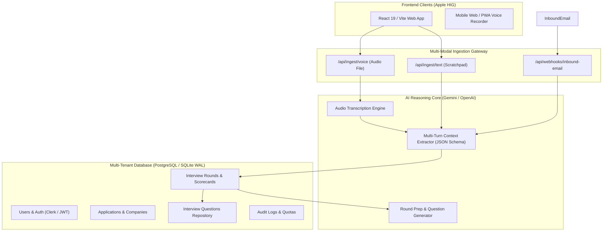

# 🚀 AI Interview Notetaker & Pipeline CRM SaaS — Design Specification

**Document Version:** 1.0  
**Target:** Multi-Tenant SaaS Platform  
**Product Vision:** A zero-friction, multi-modal AI interview copilot and application CRM that automatically parses recruiter emails, voice memos, and quick notes into structured company rounds, feedback, and preparation cheat sheets.

---

## 🎯 1. Executive Summary & Market Problem

### The Pain Point
Job seekers applying to 50–200+ roles juggle 5–15 simultaneous interview pipelines. Each company has 3–6 distinct rounds:
1. Recruiter Initial Screen
2. Technical Coding / Homework Assessment
3. System Design / Architecture Deep Dive
4. Hiring Manager & Cross-Functional Alignment
5. Executive / Culture Fit & Compensation Negotiation

**Why existing tools fail:**
- **Spreadsheets & Notion:** Require 100% manual, tedious data entry. Candidates abandon them after 3–5 days because entering every date, interviewer name, and technical question after a stressful 60-minute interview is exhausting.
- **Traditional Job Trackers (Huntr, Teal):** Function primarily as static Kanban boards with manual drag-and-drop. They do not understand interview content, do not ingest audio, and cannot parse raw recruiter emails into structured rounds.

### The Solution: Zero-Friction Multi-Modal AI Notetaker
A candidate never has to fill out long forms manually. They have three instant ways to capture an interview:
1. **🎙️ Post-Interview Voice Memo**: Candidate records a 60-second voice note while walking out of the call. The AI transcribes the audio, extracts the company, round type, questions asked, answers given, mistakes made, and follow-up items.
2. **✉️ Inbound Recruiter Email Forwarding**: Candidate forwards any recruiter email or calendar invite (e.g., from Google Meet, Greenhouse, Lever) to `track@app.domain.com`. The AI extracts the scheduled date, meeting link, interviewer names, and round objectives.
3. **📝 Scratchpad Quick-Dump**: Paste raw unstructured bullet points. The AI cleans and structures them into an interview intelligence scorecard.

---

## 🏗️ 2. Core SaaS Product Features

### Feature 1: Multi-Modal Contextual Parser (Voice + Email + Text)
- **Audio Voice Notes (Whisper / Gemini Multi-Modal)**:
  - In-browser microphone recorder with Apple-style visual audio waveform.
  - Native transcription + structured extraction prompt.
- **Inbound Email Parser**:
  - Unique user inbound alias (e.g., `kunal.92f8@mail.jobhunter.ai`).
  - Webhook integration (SendGrid / Resend Inbound) that automatically maps incoming messages to the candidate's active company application.
- **LLM Extraction Schema**:
  - `round_number`: Integer
  - `round_type`: `RECRUITER_SCREEN` | `TECH_CODING` | `SYSTEM_DESIGN` | `BEHAVIORAL` | `HIRING_MANAGER` | `EXECUTIVE` | `OFFER`
  - `interviewer_names`: Array of names and LinkedIn links
  - `questions_asked`: List of technical & behavioral questions
  - `candidate_answers_summary`: Summary of responses
  - `feedback_and_vibe`: Positives, hesitations, interviewer body language / feedback
  - `action_items`: Follow-ups (thank you notes, prep topics for next round)
  - `next_round_date`: ISO timestamp or null

### Feature 2: Structured Interview Round CRM
- **Company Card View**:
  - Timeline of all completed and scheduled rounds.
  - Overall status: `APPLIED` ➔ `SCREENING` ➔ `INTERVIEWING` ➔ `OFFER` ➔ `DECLINED` / `REJECTED`.
  - Confidence rating (1–5 stars) per round.
- **Round-by-Round Scorecard**:
  - Detailed drill-down for each round with search across all past questions.
  - Compare questions asked across different companies for similar roles.

### Feature 3: AI Interview Preparation Assistant
- Before an upcoming round, the AI generates a personalized **Round Prep Briefing**:
  - Analyzes the candidate's parsed resume and the job requirements.
  - Reviews notes from previous rounds at the same company (e.g., *"In Round 1, the recruiter mentioned the team is migrating from REST to GraphQL — prepare for GraphQL questions"*).
  - Generates top 5 predicted questions tailored to that specific company's engineering culture.

### Feature 4: Thank-You Note & Follow-Up Generator
- 1-Click generation of personalized, thoughtful post-interview thank-you emails referencing specific discussion points from the interview notes.

---

## 🏛️ 3. SaaS Technical Architecture & Data Model

### Database Schema (Relational Multi-Tenant Model)

#### 1. `users`
- `id`: UUID (Primary Key)
- `email`: String (Unique)
- `name`: String
- `inbound_email_token`: String (Unique, e.g. `kunal-x89f`)
- `subscription_tier`: String (`FREE`, `PRO`, `ENTERPRISE`)
- `created_at`: Timestamp

#### 2. `companies_tracked`
- `id`: UUID (Primary Key)
- `user_id`: UUID (Foreign Key ➔ users)
- `company_name`: String
- `job_title`: String
- `job_url`: String (Nullable)
- `recruiter_email`: String (Nullable)
- `status`: String (`WISHLIST`, `APPLIED`, `INTERVIEWING`, `OFFER`, `REJECTED`, `WITHDRAWN`)
- `created_at`: Timestamp

#### 3. `interview_rounds`
- `id`: UUID (Primary Key)
- `company_id`: UUID (Foreign Key ➔ companies_tracked)
- `user_id`: UUID (Foreign Key ➔ users)
- `round_number`: Integer
- `round_title`: String (e.g., "Round 2: System Design & Distributed Systems")
- `round_type`: String (`SCREEN`, `CODING`, `SYSTEM_DESIGN`, `BEHAVIORAL`, `FINAL`, `OFFER`)
- `scheduled_at`: Timestamp (Nullable)
- `duration_minutes`: Integer (Default: 45)
- `interviewer_info`: JSONB (Names, Titles, LinkedIn)
- `raw_input_source`: String (`VOICE_NOTE`, `EMAIL_FORWARD`, `SCRATCHPAD`, `MANUAL`)
- `raw_input_text`: Text
- `audio_url`: String (Nullable)
- `summary`: Text
- `candidate_feeling`: String (`STRONG_YES`, `MODERATE`, `NEUTRAL`, `CONCERNED`)
- `feedback_received`: Text (Nullable)
- `created_at`: Timestamp

#### 4. `interview_questions`
- `id`: UUID (Primary Key)
- `round_id`: UUID (Foreign Key ➔ interview_rounds)
- `user_id`: UUID (Foreign Key ➔ users)
- `question_text`: Text
- `question_category`: String (`CODING_DSA`, `SYSTEM_DESIGN`, `EXPERIENCE`, `CULTURE_BEHAVIORAL`)
- `candidate_answer_notes`: Text
- `areas_to_improve`: Text

---

## 💰 4. SaaS Business Model & Pricing Strategy

| Tier | Price | Features |
| :--- | :--- | :--- |
| **Free / Starter** | $0/mo | Up to 3 active companies, 10 voice memos/mo, basic email parsing, local export. |
| **Pro Candidate** | $14/mo | Unlimited companies & interview rounds, unlimited voice note transcription, automatic email forwarding alias, AI round prep briefing & predicted questions, thank-you email generator. |
| **Job Hunter Elite** | $29/mo | All Pro features + Autonomous job scraper, 1-click tailored cover letter PDF builder, and automated SMTP recruiter outreach. |

---

## 🛡️ 5. Privacy, Security & GDPR Safeguards

1. **Zero Data Scraping for Third Parties**: Candidate interview questions and voice memos are strictly private and encrypted at rest (AES-256).
2. **Audio Retention Controls**: Users can choose to auto-delete raw voice audio files after transcription while preserving structured text notes.
3. **PII Masking Option**: Option to redact personal names and compensation details before AI inference.
